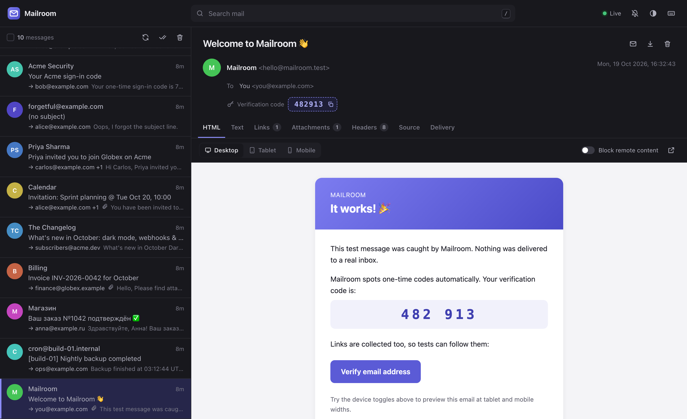

# Mailroom

**A fast, single-binary SMTP server and web inbox for testing email.**

Point your app's SMTP settings at Mailroom and every email it sends is caught — never delivered — and shown in a live web inbox. Built in Rust: one 7 MB binary, ~7 MB of memory at idle, no runtime dependencies.



## Why Mailroom

- **Zero setup.** One static binary (or a `scratch` Docker image). Messages live in memory by default; add `--db` to keep them.
- **Built for automated tests.** `GET /api/v1/messages/wait` blocks until a matching email arrives, and every message comes with its **links** and **one-time codes** already extracted — so "click the magic link" in a Playwright test is two lines.
- **Faithful SMTP.** A hand-written, fully unit-tested ESMTP state machine: `PIPELINING`, `SIZE`, `8BITMIME`, `SMTPUTF8`, `CHUNKING`/`BDAT`, `ENHANCEDSTATUSCODES`, `AUTH PLAIN/LOGIN` and `STARTTLS` (bring a certificate or let Mailroom generate one).
- **See what really happened.** The SMTP envelope is kept next to the message, so blind-copied recipients show up as *envelope-only Bcc*, and missing `Message-ID`/`Date` headers are flagged.
- **A great inbox.** Live updates over SSE, sandboxed HTML preview at desktop/tablet/mobile widths, remote-content blocking, text/source/headers/links/attachments views, Gmail-style search, keyboard shortcuts, dark mode, desktop notifications.
- **Drop-in `sendmail`.** `mailroom sendmail -t` captures PHP's `mail()`, cron and anything else that pipes to sendmail.

## Quick start

```bash
cargo install --git https://github.com/<your-account>/mailroom   # or download a release binary
mailroom
```

```
  Mailroom v0.1.0

  SMTP     127.0.0.1:1025
  Web UI   http://127.0.0.1:8025/
  Storage  in memory (newest 1000 kept)
```

Open <http://localhost:8025> and send a test email from the welcome screen, or with any client:

```bash
python3 scripts/send-samples.py          # a set of realistic sample emails
```

### Docker

```bash
docker run --rm -p 1025:1025 -p 8025:8025 ghcr.io/<your-account>/mailroom
```

```yaml
# docker-compose.yml
services:
  mailroom:
    image: ghcr.io/<your-account>/mailroom
    ports: ["1025:1025", "8025:8025"]
    environment:
      MAILROOM_DB: /data/mailroom.db   # optional: keep messages across restarts
    volumes: ["mailroom-data:/data"]
volumes:
  mailroom-data:
```

The image runs as an unprivileged user (`65534`); make sure a mounted volume is writable by it.

## Point your app at it

| Setting | Value |
| --- | --- |
| SMTP host | `localhost` (or the container name) |
| SMTP port | `1025` |
| Encryption | none (or STARTTLS, see below) |
| Username / password | anything, or nothing |

<details>
<summary>Framework examples</summary>

```js
// Node.js (Nodemailer)
nodemailer.createTransport({ host: "localhost", port: 1025, secure: false });
```

```ini
# Laravel .env
MAIL_MAILER=smtp
MAIL_HOST=localhost
MAIL_PORT=1025
MAIL_ENCRYPTION=null
```

```python
# Django settings.py
EMAIL_HOST = "localhost"
EMAIL_PORT = 1025
```

```ruby
# Rails
config.action_mailer.delivery_method = :smtp
config.action_mailer.smtp_settings = { address: "localhost", port: 1025 }
```

```ini
; php.ini
sendmail_path = "/usr/local/bin/mailroom sendmail -t"
```
</details>

## Testing with the API

The API is designed so end-to-end tests can assert on email without polling loops.

```js
// Playwright
await page.getByRole("button", { name: "Send reset link" }).click();

const res = await fetch(
  "http://localhost:8025/api/v1/messages/wait?query=to:alice@example.com subject:reset&timeout=10",
);
const email = await res.json();          // 408 if nothing arrives in time
await page.goto(email.links[0].url);     // links are pre-extracted
```

```python
# pytest + requests
email = requests.get(f"{MAILROOM}/api/v1/messages/wait",
                     params={"query": "to:bob@example.com", "timeout": 10}).json()
code = email["codes"][0]                 # e.g. "739201" from "Your sign-in code is 739201"
```

Every `/messages/{id}/…` endpoint also accepts the id **`latest`** together with `?query=`:

```bash
curl "localhost:8025/api/v1/messages/latest/links?query=to:alice@example.com"
curl "localhost:8025/api/v1/messages/latest/codes?query=subject:verify"
curl -X DELETE localhost:8025/api/v1/messages        # clean slate between tests
```

### Endpoints

All endpoints live under `/api/v1`.

| Method | Path | Description |
| --- | --- | --- |
| `GET` | `/messages?query=&limit=&offset=` | List messages, newest first, with `total`, `unread` and `matched` counts |
| `GET` | `/messages/wait?query=&timeout=&since=` | Newest matching message; waits for one if needed (408 on timeout) |
| `GET` | `/messages/{id}` | Full message: headers, text, HTML, attachments, envelope, links, codes |
| `PATCH` | `/messages/{id}` | Update a message, e.g. `{"read": true}` |
| `DELETE` | `/messages/{id}` | Delete a message |
| `DELETE` | `/messages?query=` | Delete matching messages, or everything; body `{"ids": [...]}` deletes specific ones |
| `POST` | `/messages/read` | Mark messages read/unread: `{"ids"?: [...], "query"?: "...", "read"?: true}` |
| `GET` | `/messages/{id}/raw` | Original source (`?download=1` for an `.eml` file) |
| `GET` | `/messages/{id}/html` | HTML body as a sandboxed page (`?block_remote=1` blocks remote content) |
| `GET` | `/messages/{id}/parts/{part}` | Download an attachment or inline part |
| `GET` | `/messages/{id}/links` | Links found in the message |
| `GET` | `/messages/{id}/codes` | Likely one-time / verification codes |
| `POST` | `/send` | Create a message from JSON (`from`, `to`, `cc`, `bcc`, `subject`, `text`, `html`, `headers`, `attachments`) |
| `GET` | `/events` | Server-sent events: `message.created`, `message.updated`, `message.deleted`, `messages.cleared`, `stats` |
| `GET` | `/info` | Version, listen addresses, settings and mailbox stats |

`GET /healthz` returns `ok` for health checks.

## Search

The inbox search box and every `query` parameter use the same syntax. Matching is case-insensitive and by substring.

| Query | Matches |
| --- | --- |
| `invoice` | the word anywhere: subject, addresses, body, attachment names |
| `"reset password"` | an exact phrase |
| `from:billing@` | the sender (header `From` or envelope `MAIL FROM`) |
| `to:@example.com` | any recipient: To, Cc, Bcc or envelope |
| `subject:welcome` | the subject only |
| `message-id:abc@host` | the `Message-ID` header |
| `is:unread` / `is:read` | read state |
| `has:attachment` | messages with attachments |
| `after:2026-10-01` / `before:2026-10-19` | received date (also RFC 3339 or unix time) |
| `-newsletter`, `-from:noreply` | exclude anything |

## Configuration

Every flag can also be set with an environment variable.

| Flag | Environment | Default | Description |
| --- | --- | --- | --- |
| `--smtp` | `MAILROOM_SMTP` | `127.0.0.1:1025` | SMTP listen address |
| `--http` | `MAILROOM_HTTP` | `127.0.0.1:8025` | Web UI and API listen address |
| `--db` | `MAILROOM_DB` | in memory | SQLite file to persist messages in |
| `--max-messages` | `MAILROOM_MAX_MESSAGES` | `1000` | Keep only the newest N messages (`0` = unlimited) |
| `--max-message-size` | `MAILROOM_MAX_MESSAGE_SIZE` | `25MB` | Reject larger messages with `552` |
| `--hostname` | `MAILROOM_HOSTNAME` | `mailroom` | Name used in SMTP greetings |
| `--smtp-auth` | `MAILROOM_SMTP_AUTH` | — | Require `USER:PASSWORD`; otherwise AUTH is optional and accepts anything |
| `--smtp-tls-cert` / `--smtp-tls-key` | `MAILROOM_SMTP_TLS_CERT` / `_KEY` | — | PEM files enabling STARTTLS |
| `--smtp-tls-self-signed` | `MAILROOM_SMTP_TLS_SELF_SIGNED` | off | Enable STARTTLS with a generated certificate |
| `--smtp-require-tls` | `MAILROOM_SMTP_REQUIRE_TLS` | off | Refuse `MAIL`/`AUTH` before STARTTLS |
| `--webroot` | `MAILROOM_WEBROOT` | `/` | Serve under a path prefix behind a reverse proxy |
| `--cors` | `MAILROOM_CORS` | — | Allow cross-origin API calls from these origins (or `*`) |
| `--log` | `MAILROOM_LOG` | `info` | Log filter, e.g. `debug` |

Mailroom listens on `127.0.0.1` by default so it is not exposed to your network; the Docker image binds `0.0.0.0`.

### sendmail mode

```bash
mailroom sendmail -t < message.eml            # recipients from To/Cc/Bcc headers
echo "Subject: hi" | mailroom sendmail you@example.com
```

Supports the common flags `-t`, `-i`/`-oi`, `-f <from>` and `-S host:port` (default `127.0.0.1:1025`, or `MAILROOM_SENDMAIL_SMTP`). Symlinking the binary as `sendmail` works too.

## Security notes

Mailroom is a development tool. HTML emails are rendered in a sandboxed iframe with a strict Content-Security-Policy, so scripts in an email never run; attachments are served with `Content-Security-Policy: sandbox` and `nosniff`. The API has no authentication and CORS is off by default, so do not expose it to untrusted networks.

## How it works

```
TCP connection ─► SMTP session (sans-IO state machine) ─► envelope + raw message
   ─► MIME analysis (mail-parser) ─► SQLite ─► HTTP API + SSE ─► web UI
```

```
src/
├── smtp/      session.rs (protocol state machine), server.rs (Tokio I/O), tls.rs
├── email/     parser.rs (MIME → model), extract.rs (links, codes), compose.rs
├── storage/   repo.rs (SQL), query.rs (search language)
├── api/       REST endpoints, SSE and the wait endpoint
├── app.rs     the core service shared by SMTP and HTTP
└── sendmail.rs
ui/            the web inbox: plain HTML/CSS/JS, embedded in the binary
```

The SMTP session never touches a socket, which is why every protocol rule has a fast unit test; `tests/e2e.rs` then drives a real server with real clients (lettre, STARTTLS, pipelined raw TCP, the `sendmail` binary).

## Development

```bash
cargo test                                    # unit + end-to-end tests
MAILROOM_UI_DIR=ui cargo run                  # serve ui/ from disk: edit and reload, no rebuild
python3 scripts/send-samples.py               # fill the inbox with sample emails
```

## Roadmap

- Release a caught message to a real SMTP server
- HTML compatibility report (which CSS features each email client supports)
- Spam-score and authentication checks (SPF/DKIM headers, link domains)
- Webhooks on new mail
- Chaos mode: inject SMTP failures to test retry logic
- Multiple mailboxes keyed by recipient or auth user

## License

[MIT](LICENSE)
